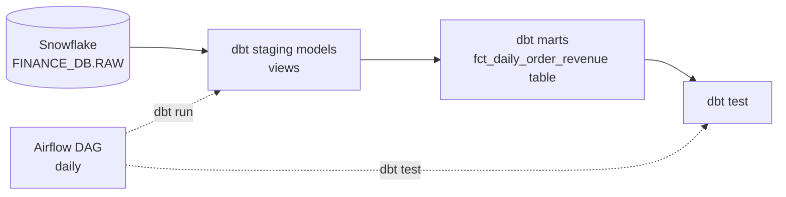
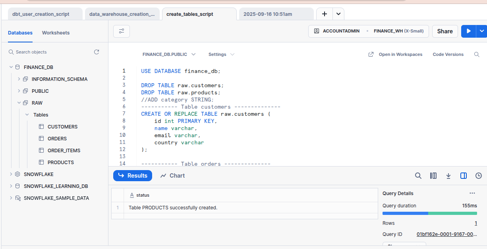
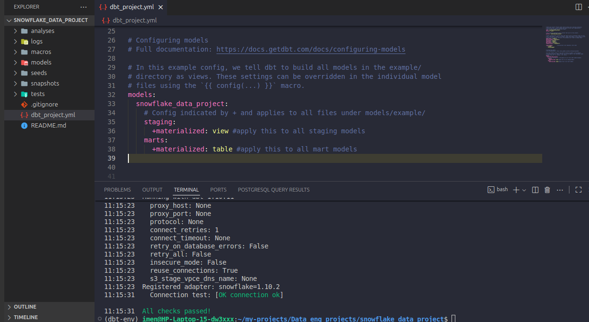
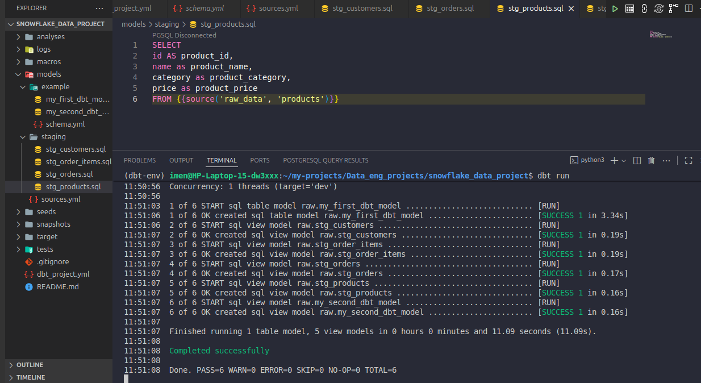
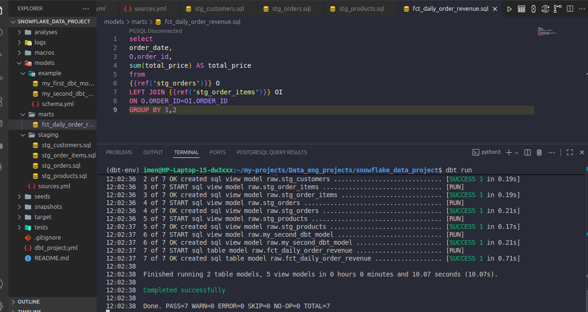
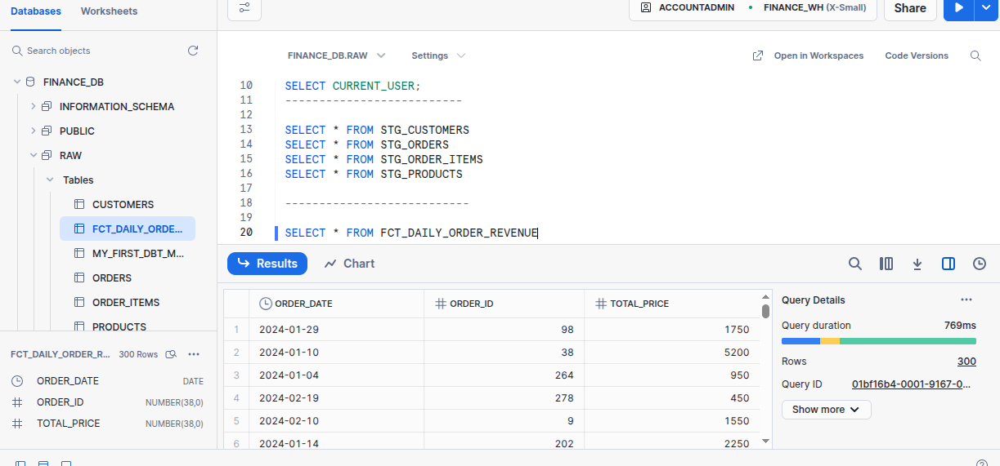
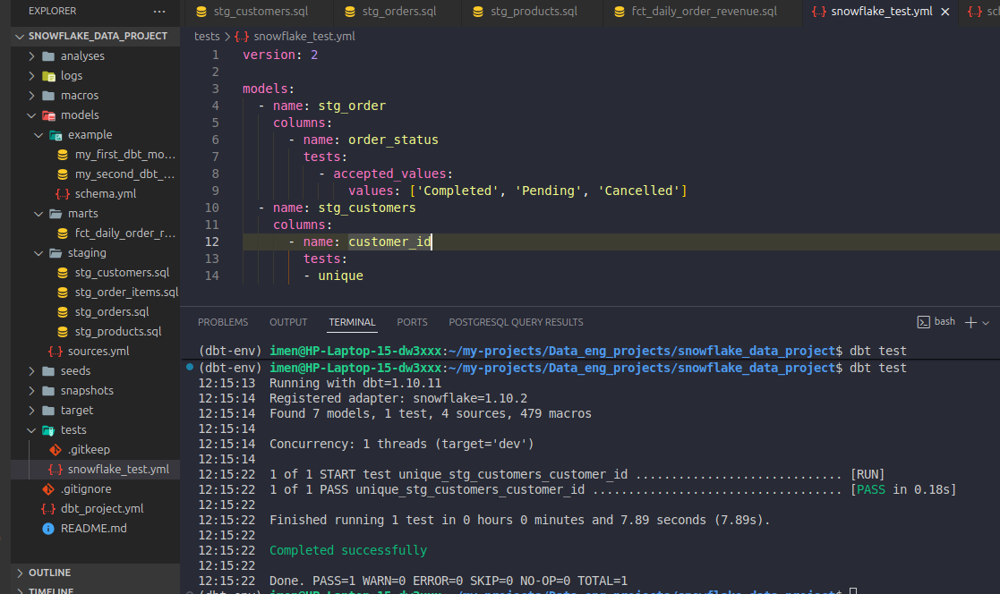
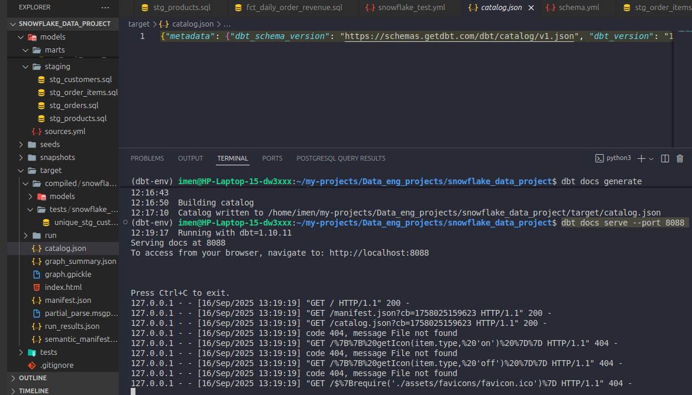
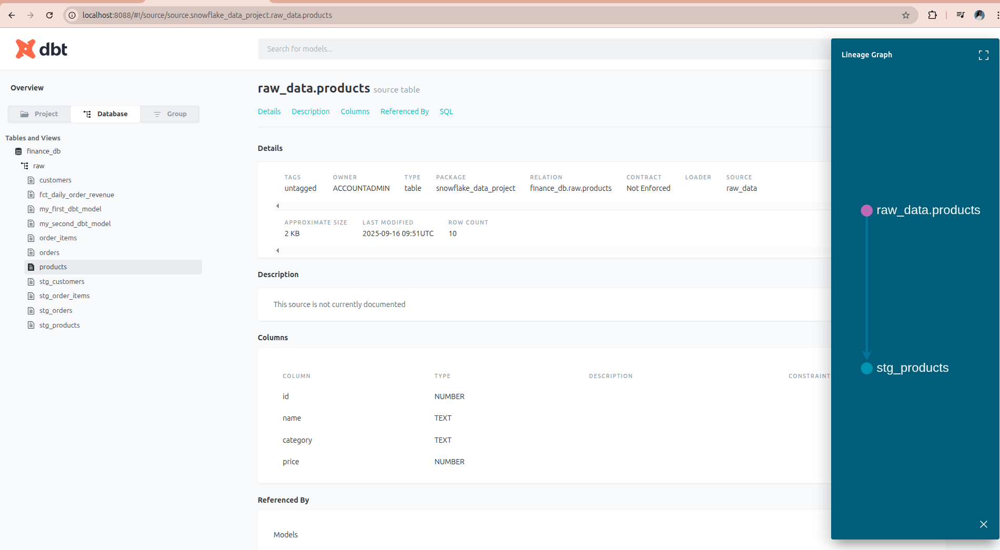

# ELT Pipeline with dbt, Snowflake and Apache Airflow

ELT project on an orders / customers / products dataset:
- Raw data is loaded into **Snowflake**.
- **dbt Core** transforms it into staging views and an analytics fact table, with data tests and generated documentation.
- **Apache Airflow** runs the dbt models and tests on a daily schedule.

## Architecture



**Tech stack:** Snowflake, dbt Core (dbt-snowflake adapter), Apache Airflow, SQL, Jinja.

## Repository structure

| Path | Content |
|---|---|
| `models/sources.yml` | Raw sources in `finance_db.raw`: customers, orders, order_items, products |
| `models/staging/` | `stg_customers`, `stg_orders`, `stg_order_items`, `stg_products`: renaming, typing, derived `total_price` (materialized as **views**) |
| `models/marts/` | `fct_daily_order_revenue`: revenue per order and date (materialized as a **table**) |
| `tests/` | dbt data tests |
| `airflow/dags/dbt_dag.py` | Daily DAG: `dbt_run >> dbt_test` |
| `docs/images/` | Screenshots of each step |

## Steps

### 1. Set up Snowflake

Create the warehouse (`FINANCE_WH`), the database (`FINANCE_DB`), the `RAW` schema and a dedicated dbt user, then create and load the raw tables.

Each worksheet runs in a context made of a role, a warehouse, and a database and schema. For large files, load through a stage with `COPY INTO`.



### 2. Configure the dbt project

Staging models are materialized as views and marts as tables (`dbt_project.yml`). `dbt debug` checks the Snowflake connection.



### 3. Build the staging models

Each staging model selects from a declared source (`{{ source('raw_data', ...) }}`) and renames or derives columns.



### 4. Build the fact table

`fct_daily_order_revenue` joins `stg_orders` and `stg_order_items` with `{{ ref() }}` and aggregates the revenue per order and date.





### 5. Run data tests



### 6. Generate the documentation and lineage

```bash
dbt docs generate
dbt docs serve --port 8088
```






### 7. Schedule with Airflow

dbt Core has no scheduler of its own. The Airflow DAG `dbt_snowflake_workflow` runs `dbt run` and then `dbt test` every day. Set `DBT_PROJECT_DIR` in `airflow/dags/dbt_dag.py` to your local path.

## Run it locally

```bash
pip install dbt-snowflake apache-airflow
dbt debug     # needs a Snowflake profile in ~/.dbt/profiles.yml
dbt run
dbt test
```

## Credits

Based on [ansamAY/dbt_snowflake_project](https://github.com/ansamAY/dbt_snowflake_project).
